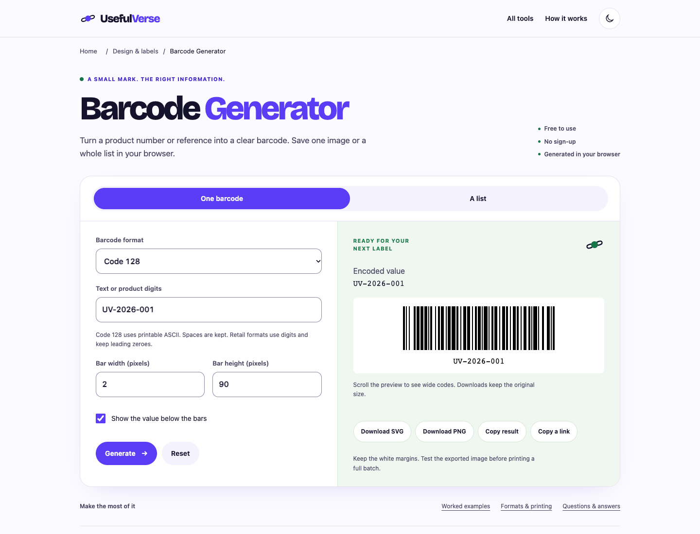

# Barcode Generator · candidato nivel A

29-oct-2026 · [PR147](https://github.com/pedronunezwebs-hash/usefulverse/pull/147), sobre PR146→145→144.
Fuente [1434a77](https://github.com/pedronunezwebs-hash/usefulverse/commit/1434a7743610a0c380b8aa72dc4a7e2393aed480), más ajuste final de anchura de pestañas.
**Preparado, sin publicar ni terminar.** Prioridad4:1.942 impresiones/cero clics históricos (1–15 oct).
25.625 URLs públicas antes/después, delta0;300 nuevas conservan noindex, cero activaciones.

## Funciones y contenido

Conserva Code128/EAN13/UPC-A, texto bajo las barras y descargas SVG/PNG. Añade EAN8/Code39,
controles de ancho/alto y lote cancelable: un SVG por línea válida, ZIP y manifest.csv con entradas/errores.
Elimina el límite artificial de80 caracteres; prueba de1.000 caracteres completos y decodificados.
La vista previa muestra cinco imágenes; el ZIP conserva todas. Duplicados intencionales producen el mismo código.

Generación/ZIP en Worker; cancelación por terminación e IDs para evitar resultados antiguos. Texto/SVG escapados,
archivos numerados sin usar nombres de entrada, CSV protegido contra fórmulas, ceros iniciales preservados.
PNG se comprueba antes de ofrecerlo; si el canvas del navegador no soporta una imagen enorme, SVG sigue disponible.
Barra de1–6px/alto40–300px son ajustes visuales de salida, no cupos de datos ni una especificación física certificada.
Negro sobre blanco y doce módulos libres a cada lado, incluso en tema oscuro; vista previa ancha con scroll propio.

Cuatro ejemplos, diez FAQ, reglas de impresión/privacidad y [20 intenciones](keywords.json) en una URL existente.
Tareas inferidas de funciones/productos, **no volúmenes, ranking ni PAA medidos**. Referencias de producto:
[TEC-IT](https://barcode.tec-it.com/en), [Orca Scan](https://orcascan.com/tools/barcode-generator),
[bwip-js](https://bwip-js.metafloor.com/). Sin plataforma SEO ni API pagada.
La copia explica que calcular el checksum no asigna un GTIN; ejemplos no ofrecidos como números comerciales.
Code128 ordinario no es GS1-128; Code39 no añade el checksum opcional Modulo43.



[Móvil](mobile.webp) · [Resultado](mobile-result.webp) · [320px](mobile320.webp) · [Tablet](tablet.webp) ·
[Lote](batch.webp) · [Oscuro](dark.webp) · [Fixture RTL](rtl-layout.webp).
Capturas de viewport inspeccionadas; fixtures RTL/largos no aprueban traducciones reales ni zoom del navegador.

## Base e independencia

Reutiliza página/CSS/fuente/build compartidos sin modificarlos. JsBarcode3.12.3 MIT y fflate0.8.3 MIT,
ya fijados en el repo, empaquetados/autoalojados con licencias; sin llamada a un servicio de códigos.
ZXing0.21.3 Apache2 es **solo dependencia de QA**, instalada en prefijo propio; no se entrega a visitantes.
Los builders nativos, runtime público, workflows/índices y traducciones existentes no cambian.
Build optativo noindex/sitemap vacío/canonical existente; ninguna700 pública recibe noindex.
Nuevo inglés centralizado, aún fuera del corpus activo: incorporarlo revisado en lote separado preservando UI pública;
no reconfigurar traductor ni traducir manualmente.

## Pruebas ejecutadas

- [3.382 Node](tests.json), cero fallos/omisiones;23 focalizadas, doce [referencias independientes Python/GS1](references.json),
  5.000 cuerpos aleatorios con rechazo de cada dígito final incorrecto,1.000 referencias distintas y valor de1.000 caracteres.
  Una referencia está impresa por GS1; las restantes se derivan de su algoritmo con otro código, sin alegar asignación real.
- [Decodificador independiente](independent-decode.json):1.016 filas de barras recuperadas mediante ZXing, ajeno al generador.
  Además [tres navegadores](browser.json) descargan y decodifican los **SVG y PNG reales de los cinco formatos:30 archivos**.
- Chrome/Firefox/WebKit:48 controles,54 geometrías claro/oscuro a320–1920px, axe A/AA0;
  doce apaisados, RTL/largos/texto200, teclado/errores, opciones, cuatro ejemplos, copiar/enlace y offline tras primera carga.
  Cada motor descarga ZIP de1.000 SVG y manifiesto completo; errores por fila/CSV seguro, cancelación de10k líneas,
  respuestas antiguas descartadas. Márgenes≥16px, sin desbordamiento de página/terceros/errores de consola.
  Portapapeles simulado y descargas automatizadas no certifican el sistema móvil real.
- [Regresiones](regressions.json): límite80 reproducido en producción; ejemplos con dígitos largos desbordaban402px
  al duplicar texto a390px. Candidato corrige ambos con pruebas permanentes; ningún arreglo desplegado.
- [Lighthouse](lighthouse.json):100/100/100,LCP934ms/CLS0/TBT0; [traza fría Slow4G/CPU×4](performance-trace.json):877ms/CLS≈0, laboratorio local.
  INP de campo/impresión/dispositivos reales no medidos. Python no reproduce cabeceras ni compresión de Cloudflare.
  La traza precede solo el ajuste visual de pestañas; suite completa precede ese mismo ajuste, navegador/focalizadas repetidos.
- [Peso exacto](candidate.json):HTML9.350B Brotli,CSS3.915B,JS+Worker19.068B,fuente40.784B; **73.117B** estimados. CSS crítico13.553B sin comprimir. Fuente WOFF2 compartida,
  sin otro binario. Build rechaza presupuesto excedido/checksum de fuente incorrecto.
- [Producción](production.json): cuatro navegaciones Chrome HTTP200/H1 correctos; Code128 UV-2026-001,
  EAN13 9412345543219 y UPC-A012345678905 correctos. Solo widget antiguo; candidato **no publicado**.
  urllib obtuvo403 y se sustituyó por navegación real, sin afirmar que producción estuviera caída.
- Gate20 existente correcto, no acredita el nuevo texto. No se repiten builds nativos sin cambios;
  check del sitio integrado/CSP/caché/cobertura/hreflang e idiomas reales siguen pendientes.

## Puerta RUNBOOK §6

| # | Situación |
|---|---|
| 1 Funciona | Referencias/propiedades/extremos; SVG/PNG y ZIP reales en tres motores |
| 2 Límites | Cap80 eliminado,1.000 generaciones/lote, memoria real explicada |
| 3 Rejugable | Generador determinista: misma entrada debe dar mismas barras;1.000 entradas distintas dan códigos distintos |
| 4 Originalidad |0/922 frases de cinco palabras compartidas como máximo |
| 5 Ejemplos | Cuatro recalculados y ejecutados por navegador |
| 6 Metadata | Título49/descripción141, únicos y con promesas honestas |
| 7 Esquema | WebApplication/Breadcrumb/FAQ idénticos al DOM |
| 8 Siguiente paso | Tres relacionadas HTTP200; lector enlazado declara que es solo QR |
| 9 Claridad | Revisión de agente; formatos/impresión explicados; diseño Pedro pendiente |
| 10 Rendimiento | Laboratorio bajo presupuesto; INP campo pendiente |
| 11 Accesibilidad | axe/teclado/contraste; lector real pendiente |
| 12 RTL/largos | Fixtures correctos; ar/de reales pendientes |
| 13 Idiomas | Solo nuevo inglés; piloto/cobertura/hreflang pendientes |
| 14 Check/release | Gate20 existente pasa; integración/check/CSP/caché pendientes |
| 15 Siete capas |1–4 ejecutadas;5–7 parciales por idiomas/dispositivos/revisión |
| 16 Pedro | P-010 plantilla común y P-011 impresión/lector real; bloqueadas hasta URL candidata |
| 17 Peso | Build dentro de cada presupuesto, ver candidate.json |
| 18 Responsive | Nueve anchos/temas/apaisados/estrés; zoom real200/diseño pendientes |

## Relevo y reproducción

Mantener pila PR144→145→146→147. No publicar esta rama como candidato de fase0.
Completar las puertas pendientes antes de publicar/cerrar; widget insertable del nivelA todavía pendiente.
Siguiente preparación: prioridad5 `fraction-calculator`. Reutilizar base/pruebas comunes y contenido/motor propios.
[Traductor](translation-status.json):40843674935 sigue sola, cuatro jobs primera vuelta; configuración intacta.
105.639 exportadas corresponde al último aviso anterior, no una nueva lectura completa ni destinos aprobados.

Clon ligero,≥10GB libres/huella≤2GB, dependencias/caché/perfiles en prefijo propio; un trabajo pesado cada vez.
Dependencias fijadas del package-lock y QA adicional `@zxing/library@0.21.3`; symlink node_modules al prefijo propio.
No modelos, Actions de web, Codespaces ni servicio nuevo. Licencias de JsBarcode/fflate acompañan el build.

```sh
node --test src/quality/barcode-generator/*.test.mjs
node scripts/security/barcode-decode.mjs
node scripts/build-quality-barcode.mjs .qa-barcode/site
python3 -m http.server 54839 --bind 127.0.0.1 --directory .qa-barcode/site
PLAYWRIGHT_BROWSERS_PATH="$PWD/.qa-barcode/browsers" node scripts/security/barcode-quality-browser.mjs http://127.0.0.1:54839/ .qa-barcode/browser.json
node scripts/security/quality-lighthouse.mjs http://127.0.0.1:54839/tools/barcode-generator/ .qa-barcode/lighthouse.json
```

El cierre y retirada se documentarán aquí tras comprobar el respaldo remoto.
