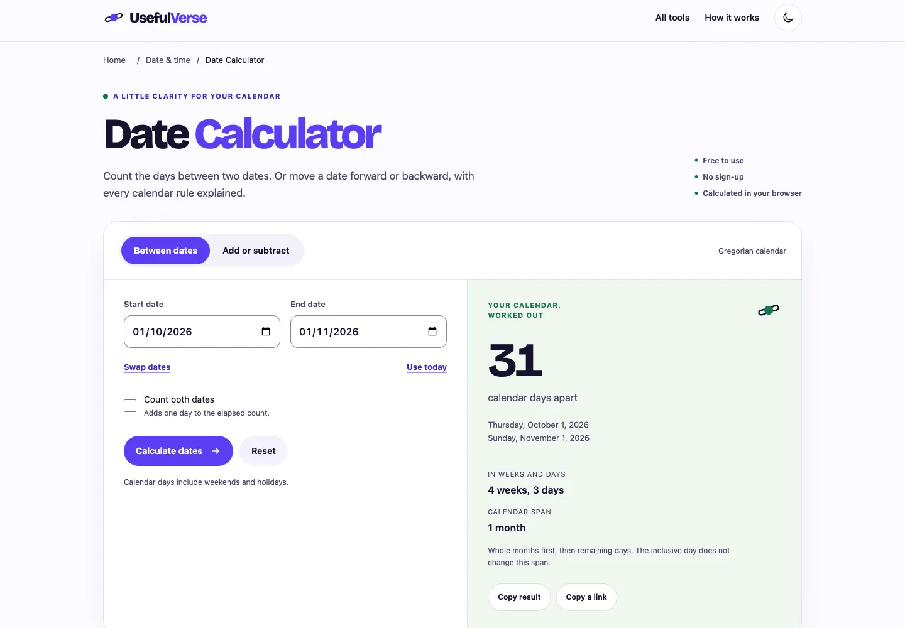

# Date Calculator · preparación nivel A / Planeta Infinito

29-oct-2026 · **No publicada, no terminada, no apta todavía para integrar en producción.**
[PR144](https://github.com/pedronunezwebs-hash/usefulverse/pull/144) · [fuente e9e93b5](https://github.com/pedronunezwebs-hash/usefulverse/commit/e9e93b553cf077d0c120fc5278388dea1f8955b8). Rama `feat/date-calculator-planeta`. Prioridad 1: 2.547 impresiones y dos clics históricos (1–15 oct),
24 idiomas con impresiones. Se mejora una URL existente; **delta de URLs indexables: 0**.

## Qué mejora

Antes: distancia en días y desplazamiento por días, explicación breve. El candidato añade:

- Diferencia en días, semanas y tramo de años/meses/días; conteo inclusivo explícito y orden invertido explicado.
- Sumar/restar años, meses, semanas y días; fin de mes ajustado o rechazado a elección del usuario.
- Día de la semana, hoy local, intercambio, cuatro ejemplos ejecutables, copiar resultado/enlace y alternativa cuando se deniega el portapapeles.
- Diseño de la marca aprobada: tipografía propia autoalojada, formulario claro, resultado separado, temas claro/oscuro, teclado y movimiento reducido.
- Texto inglés original por herramienta, diez FAQ, método, límites honestos, privacidad y tres siguientes pasos.
- [24 intenciones de búsqueda](keywords.json), cubiertas por funciones/contenido dentro de la misma URL. Son hipótesis de tareas,
  **no volúmenes ni posiciones medidos**. Sin plataformas SEO de pago, variantes de URL ni relleno repetitivo.



[Móvil](mobile.webp) · [Resultado móvil](mobile-result.webp) · [Tablet](tablet.webp) ·
[Oscuro](dark.webp) · [Ejemplos y método](examples.webp) · [Fixture RTL](rtl-layout.webp).
Capturas inspeccionadas de viewport; el fixture RTL conserva inglés y sirve solo para probar geometría.

## Arquitectura y aislamiento

El motor civil usa UTC solo como representación de fechas gregorianas; no suma horas locales ni promedios de mes.
No añade librerías al runtime. Código y copia están en `src/quality/date-calculator/` y
`translation-sources/date-calculator.json`; el nuevo inglés queda preparado para el lector existente del traductor.
**No se cambian sus siete workflows, modelos, memoria, campaña ni source_ref.** Esta rama aún no es su fuente activa.

`scripts/build-quality-date.mjs` es una construcción explícita y aislada. Los dos builders nativos, el runtime existente,
las traducciones publicadas, sitemaps y la indexabilidad de las 700 permanecen intactos. La salida del prototipo lleva
noindex, canonical de la URL existente y sitemap vacío; no se ha subido a Cloudflare.
CSS/JS/fuente tienen hash. Fuente OFL con procedencia/SHA; el build verifica checksum y presupuestos.

## Evidencia ejecutada

- [Suite](tests.json): **3.302 Node correctas, cero fallos/omisiones**; 30 nuevas de esta herramienta.
  Catorce referencias [Python](reference-python.json), cinco ejemplos publicados de MDN y 10.000 casos generados.
- [Navegadores](browser.json): Chrome instalado, Firefox y WebKit; 12 controles funcionales por motor,
  54 geometrías claro/oscuro a 320, 360, 390, 414, 768, 1024, 1280, 1440 y 1920 px.
  axe A/AA cero, sin errores de consola/página ni peticiones a terceros. Márgenes móviles ≥16 px.
  Además RTL/texto largo sintéticos, texto al 200 % y cuatro anchos apaisados por motor.
- [Regresiones](regressions.json): año 10000 truncado en el código anterior, número nativo incompleto,
  contraste de campos, resultado fuera de la vista móvil y cabecera desbordada con texto al 200 %.
  El problema de año 10000 está reproducido en la fuente antigua; su arreglo aún no está en producción.
- [Lighthouse 13.6 móvil](lighthouse.json): **100/100/100**, LCP 944 ms, CLS 0, TBT 0.
  [Traza Chrome](performance-trace.json), caché fría, CPU×4/Slow4G: LCP **885 ms**, CLS 0.
  Antes del CSS crítico: 1.580 ms. Es laboratorio local, **no INP de usuarios reales ni garantía de producción**.
- [Peso](candidate.json): HTML 9.063 B Brotli, CSS completo 3.684 B, JS 3.145 B, fuente 40.784 B;
  total estimado **56.676 B**. CSS crítico 14.169 B sin comprimir, menor que 14 KiB. JS bloqueante: 0.
  Servidor Python sin compresión/cabeceras de Cloudflare; el peso Brotli se calcula separadamente.
- [Producción](production.json): navegación fresca en Chrome confirmó HTTP 200/H1 correctos en los tres siguientes pasos
  y la calculadora actual. Sigue la versión anterior. No se ha probado en producción este prototipo.
- `locale:release-check` pasa para los 20 destinos existentes de ese gate. **No aprueba el nuevo texto ni 37 traducciones.**
  `npm run check` completo no se repite en esta preparación aislada: builders/runtime nativos no cambiaron y su evidencia
  está en `phase-0-v1/`. Habrá que ejecutarlo al integrar la plantilla; ese control no se da por cerrado aquí.

## Puerta de calidad y pendientes concretos

| RUNBOOK §6 | Situación del prototipo |
|---|---|
| 1 Función | Casos normales/extremos/inválidos y tres motores correctos |
| 2 Límites | Sin cupo diario; rango nativo declarado y probado; 10.000 casos generados. Archivos no aplican |
| 3 Rejugable | No aplica: calculadora determinista |
| 4 Originalidad | Máximo 3/912 frases de cinco palabras compartidas con otro propietario: 0,33 %; no certifica toda la web |
| 5 Ejemplos | Cuatro botones y cifras secundarias recalculados |
| 6 Metadata | Título 56/descr.153 caracteres; única frente a otras herramientas nativas; promesas revisadas |
| 7 JSON-LD | WebApplication/Breadcrumb/FAQ; diez FAQ idénticas al DOM |
| 8 Siguiente paso | Tres rutas existentes, HTTP200/H1 correctos en producción; tareas de esas herramientas fuera de este lote |
| 9 Claridad | Revisión de agente: elegir tarea → fechas → calcular → respuesta visible; pendiente aprobación de diseño de Pedro |
| 10 Rendimiento | Laboratorio dentro de presupuesto; INP de campo/entrega real sin certificar |
| 11 Accesibilidad | axe/teclado/contraste correctos; lectura con lector de pantalla real pendiente |
| 12 RTL/largos | Fixtures sintéticos correctos; traducciones ar/de reales pendientes |
| 13 Idiomas | Solo fuente inglesa; faltan piloto, traducciones nuevas y hreflang al integrar |
| 14 Check/release | Gate20 correcto; check integrado pendiente |
| 15 Siete capas | 1–4 ejecutadas; 5–7 parciales por idiomas, dispositivos y revisión final |
| 16 Pedro | P-010 preparado, bloqueado hasta URL candidata; ninguna prueba de cámara/micrófono corresponde |
| 17 Peso | Presupuesto de build correcto |
| 18 Responsive | Nueve anchos, claro/oscuro, apaisados, estrés y texto200 correctos; zoom real200/aprobación visual pendientes |

P-010 agrupa solo calendario/portapapeles reales y aprobación visual. **No pedir a Pedro que pruebe la versión antigua**;
antes se necesita una URL candidata y completar el enlace de esa fila. No hay prueba física de micrófono, cámara o archivos.
Falta revisión de pantalla con VoiceOver/NVDA y zoom real de navegador; el fixture de texto duplicado no los sustituye.

## Cómo continuar sin repetir trabajo

1. Leer ESTADO: entregar fase 0/G1 cuando corresponda; no usar esta rama como despliegue del hub/principal.
2. Revisar las capturas y el contenido. Conservar este candidato mientras se verifica fase 0.
3. Integrar después como plantilla opt-in de la URL existente, con CSP/caché/check/release del sitio unificado;
   mantener todas las traducciones existentes hasta que los reemplazos pasen la puerta.
4. Hacer procesar el nuevo inglés por el traductor ya configurado, cuando se apruebe su incorporación a la fuente activa.
   Validar en/es/de/ar/ja/hi/nb reales; no presentar fixtures como traducciones aprobadas.
5. Completar los controles pendientes y URL/P-010; solo entonces integrar/publicar según la ventana diaria.
   Mientras tanto, preparar la siguiente herramienta de progress.csv en otra rama, sin bloqueo por espera de despliegue.

Reproducción local (nunca Actions): Node con `esbuild@0.28.2`, `fast-check@4.10.2`,
`playwright@1.64.1`, `axe-core@4.14.0`; para Lighthouse usar 13.6.0.
Instalar solo lo necesario en prefijo propio, navegadores en carpeta propia y aplicar guardia ≥10GB/huella≤2GB.

```sh
node --test src/quality/date-calculator/*.test.mjs
node scripts/build-quality-date.mjs .qa-date/site
python3 -m http.server 54839 --bind 127.0.0.1 --directory .qa-date/site
PLAYWRIGHT_BROWSERS_PATH="$PWD/.qa-date/browsers" node scripts/security/date-quality-browser.mjs http://127.0.0.1:54839/ .qa-date/browser.json
```

El navegador instalado de Chrome evita otra descarga. El harness crea y retira sus propios perfiles.
No iniciar tres builds completos ni descargar modelos. Las capturas aprobadas serán la referencia visual tras la decisión de Pedro.

[Recibo de respaldo y retirada](closure.json). Candado operativo en ESTADO.
