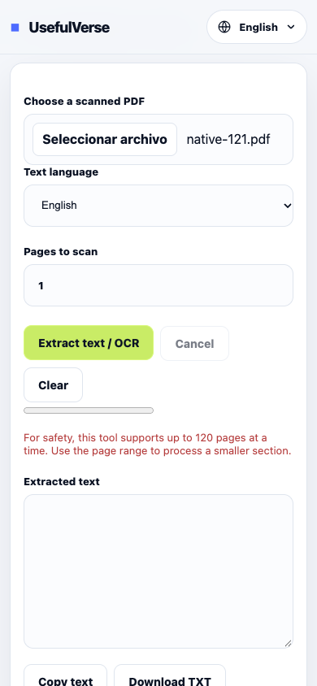

# PDF OCR · base en curso, prioridad15

29-oct-2026 · [PR150](https://github.com/pedronunezwebs-hash/usefulverse/pull/150), sobre PR148.
**Trabajo parcial: todavía no hay nueva interfaz ni herramienta terminada.** No publicado,0activaciones/delta0URLs.
Native controller/builders/publicación y traductor permanecen intactos.

## Fallo reproducido antes del arreglo

Con [este PDF sintético de121páginas](fixtures/native-121.pdf), pedir solo la página1 falla en producción:
el código comprueba `pdf.numPages >120` antes de leer la selección y recomienda reducir el rango, aunque hacerlo no ayuda.
[Prueba real Chrome/PDF.js](production-limit.json), HTTP200, sinPOST ni recursos fallidos.



El MCP no pudo seleccionar el archivo desde esta carpeta. La reproducción final se hizo con la sonda local/manual
Playwright del repositorio; un intento previo sin archivo no se cuenta como prueba de este fallo.
No se cambió el widget público. El test permanente del pipeline exige poder procesar página1 de121.

## Preparado

`src/quality/pdf-ocr/pipeline.mjs`: rangos únicos/ordenados sin cupo120; una página y un raster activos cada vez;
OCR solo cuando corresponde, worker reutilizado, progreso por páginas y entrega inmediata a un consumidor.
Modos auto/force/existing explícitos; una sola letra nativa sigue siendo texto, sin forzar descarga de modelo.
Auto conserva texto nativo existente; para documentos mixtos con un pequeño texto sobre una imagen habrá que ofrecer force.
No se promete que una heurística distinga siempre el escaneo del texto principal.

Cancelación interrumpe la espera de reconocimiento y termina el worker. Si documento, página, raster o modelo terminan
de inicializar después de cancelar, su recurso se libera sin publicar el resultado. Los adaptadores deben permitir cancelar
su propio trabajo; la limpieza tardía no garantiza detener una descarga aún no expuesta por Tesseract.
La interfaz futura deberá comprobar además su ID de trabajo antes de actualizar el DOM/descargas.
La limpieza es de mejor esfuerzo y no sustituye una prueba real de recursos en navegador.

La opción de PDF buscable se pasa explícitamente al contrato de reconocimiento y se rechaza una respuesta ausente.
**No hay aún adaptador de salida PDF ni validación independiente de ese archivo.** El test de formato utiliza un doble
de prueba: no demuestra que un PDF real sea buscable ni válido.
Tesseract7 contiene salidaPDF opcional en su [implementación oficial](https://github.com/naptha/tesseract.js/blob/v7.0.0/src/worker-script/utils/dump.js);
se habilita expresamente porque [no viene activa](https://github.com/naptha/tesseract.js/blob/v7.0.0/src/worker-script/constants/defaultOutput.js).

## Verificación ejecutada y límites

- [3.579 Node completas](node-full.log),0fallos/0omisiones,51.564ms.22tests nuevos del pipeline:rangos/errores,
 5.000casos generados,1.000páginas secuenciales, inicialización tardía, rechazo de texto/modelo/salida, fallo del consumidor,
 reconocimiento que no se resuelve y resultados después de cancelar. **Adaptadores simulados** para probar estas carreras.
- [Diez referencias PDF](references.json), obtenidas por pypdf6.10.0 de tres documentos creados con ReportLab4.4.9/Pillow12.3.0:
 páginas1/10/50/100/120/121 del PDF nativo, un escaneo sin texto y documento mixto de tres páginas (A/escaneo/blanco).
 Son referencias de estructura/texto PDF, **no diez valores de precisiónOCR**.
- [OCR real en producción antigua](production-with-scan-scan.json): una página sintética inglesa, tres líneas exactas,
 sinPOST ni peticiones fallidas. Confirma el motor existente, no la integración del nuevo pipeline ni otros idiomas.
 [Escaneo renderizado](synthetic-scan.png) y [página121](synthetic-page121.png) inspeccionados con Poppler.
 Ningún dato personal ni documento de terceros. [Fixtures](fixtures/) y generador versionados para repetirlo.
- No hay todavía build optativo/UI, Lighthouse/axe/responsive del nuevo OCR, pruebas de salidaPDF seleccionable,
 archivos grandes/reales, tres motores o idiomas de reconocimiento. No se atribuye la QA de las calculadoras a esta herramienta.

## Puerta de calidad pendiente

| # | Estado real |
|---|---|
| 1 Funciona | Base probada; adaptadores reales y precisiónOCR pendientes |
| 2 Límites | Core procesa1000páginas secuenciales; integración/memoria real pendientes |
| 3 Rejugable | N/A, conversor de archivos determinista |
| 4 Originalidad | Copy público nuevo sin preparar |
| 5 Ejemplos | Fixtures sintéticos preparados; ejemplos de UI por hacer |
| 6 Metadata | Mantener URL; nueva metadata por hacer |
| 7 Esquema | UI/FAQ nuevas por hacer |
| 8 Siguiente paso | Grafo/transferencia de archivos por implementar |
| 9 Claridad | UI/estado/error/cancelación por integrar |
| 10 Rendimiento | Sin medición del candidato completo |
| 11 Accesibilidad | Sin UI nueva para medir |
| 12 RTL/largos | Pendiente de UI e idiomas reales |
| 13 Idiomas | Conservar16 idiomasOCR existentes;37UI necesitan puerta y corpus revisado |
| 14 Check/release | Suite Node pasa; build/check/CSP/caché/idiomas del candidato pendientes |
| 15 Siete capas |1–3 parciales;4–7 pendientes del candidato real |
| 16 Pedro | Sin ID nuevo para código sin UI; añadir solo prueba aplicable de archivo/dispositivo real cuando exista candidata |
| 17 Peso | Sin candidato completo para presupuestar; cargas OCR deberán ser perezosas |
| 18 Responsive | Sin nueva interfaz para revisar |

## Siguiente paso exacto

1. Conectar adaptadores reales PDF.js6.3.289, Tesseract7 y pdf-lib1.17.1 ya fijados en el repo. Sin modelosLLM,
 API pagada, dependencia nueva ni descarga antes de pulsar procesar. Conservar16 idiomasOCR autoalojados/licencias.
2. Generar salidaPDF con texto seleccionable, procesando página a página; conservar páginas/rotaciones y explicar cualquier
 rasterización/pérdida de funciones. Comprobar texto con extractor independiente y comparar render del original/salida.
3. Probar native121, escaneo, mixto/blanco, cancelación real y fallos de modelo. No usar dobles de prueba para certificarOCR.
4. UIPlaneta de archivos: elegir/soltar/pegar, cola, progreso, cancelar y borrar que terminen el trabajo y limpien descargas.
 No conservar resultados antiguos después de cambiar entrada. Contenido/20intenciones en URL existente, cuatro ejemplos/diezFAQ.
5. Repetir las siete capas/18controles, alimentar solo el inglés revisado al corpus y publicar cuando el orden de fases lo permita.

Investigación de productos (29oct):[iLovePDF](https://www.ilovepdf.com/ocr-pdf),[PDF24](https://tools.pdf24.org/en/ocr-pdf),
[Adobe](https://www.adobe.com/acrobat/online/ocr-pdf.html). Comparación de funciones, sin ranking/volúmenes/PAA inventados;
[intenciones planeadas](keywords.json), todavía sin afirmar que estén implementadas. Sin copiar promesas de servidor.
PDF-IA trata otra mejora futura; esta base no añade resumen/traducción de PDF ni modelos pesados.

Repetición:

```sh
node --test src/quality/pdf-ocr/pipeline.test.mjs
python3 scripts/security/pdf-ocr-fixtures.py --out .qa-ocr/fixtures
PLAYWRIGHT_BROWSERS_PATH="$PWD/.qa-ocr/browsers" node scripts/security/pdf-ocr-legacy-probe.mjs .qa-ocr/production.json .qa-ocr/fixtures/native-121.pdf .qa-ocr/fixtures/scanned-one.pdf
```

Python necesita las versiones indicadas y Arial local para el escaneo; no se distribuye la fuente.
La sonda del widget antiguo espera el defecto120: no ejecutarla como aceptación después de corregir producción.
Usar carpeta propia nueva,≥10GB libres/≤2GB de huella y un trabajo pesado cada vez; limpiar después de respaldar.
