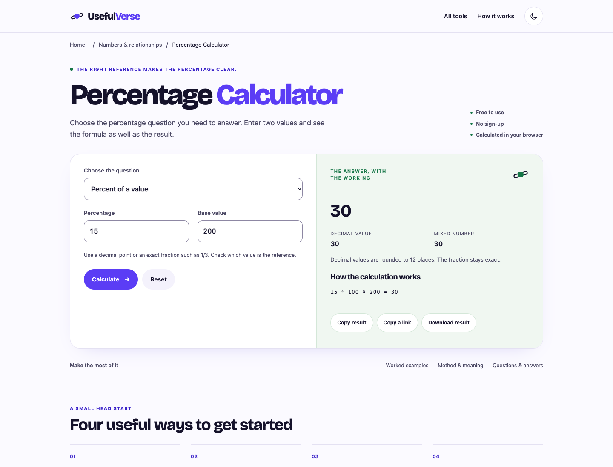

# Percentage Calculator · candidato nivel A

29-oct-2026 · [PR148](https://github.com/pedronunezwebs-hash/usefulverse/pull/148), sobre PR147→146→145→144.
Fuente [c056ff1](https://github.com/pedronunezwebs-hash/usefulverse/commit/c056ff18c7b3fe8b6c89b15e3669518762a34f5f).
**Preparado, sin publicar ni terminar.** 25.625 URLs públicas antes/después, delta0;300 noindex, cero activaciones.

Ocho preguntas diferenciadas, referencia visible y fracciones exactas. Cambio desde cero se declara indefinido; base negativa usa valor absoluto y diferencia simétrica usa valores no negativos.

Cuatro ejemplos propios, diez FAQ, método, usos y privacidad; 26 intenciones en la URL existente.
Son tareas inferidas de funciones y referencias, no volúmenes, posiciones ni PAA observados. Investigación ampliada de consultas sigue pendiente.
Referencias consultadas:

- https://www.calculator.net/percent-calculator.html
- https://docs.python.org/3/library/fractions.html



[Móvil](mobile.webp) · [Resultado](result.webp) · [Tablet](tablet.webp) · [Oscuro](dark.webp) ·
[Fixture RTL](rtl.webp) · [Largos](long-text.webp) · [Texto200](text200.webp).
Revisión visual de las diez en móvil/tablet/escritorio; oscuro y fixtures son QA, no traducciones reales ni dispositivos físicos.

## Evidencia

- [12 referencias independientes](references.json), ejemplos recalculados y propiedades permanentes; ver [suite común](../../math-batch-1/README.md).
- [Tres motores](browser.json):30 controles funcionales/54 geometrías a320–1920px, dos temas, axe0;
  doce apaisados, RTL/largos/texto200. Márgenes≥16px, teclado, error sin resultado viejo, compartir/descarga y offline.
  Portapapeles simulado; sin terceros ni errores de consola. Aleatorios restaura opciones, genera otra tirada válida.
- [Lighthouse13.6 móvil](lighthouse.json):100/100/100,LCP936ms/CLS0.005682/TBT0. Laboratorio local sin cabeceras/compresión Cloudflare; INP de campo no medido.
- [Peso](candidate.json):56,424B estimados, fuente compartida40.784B incluida; CSS crítico13.381B.
  Cada Worker solo incluye su motor. Valores exactos BigInt/racionales, cálculo pesado cancelable y sin llamadas a API.
- [Producción existente](../../math-batch-1/production.json): widgets antiguos comprobados y22 navegaciones HTTP200.
  Ninguna función nueva está publicada. [Regresiones encontradas](../../math-batch-1/regressions.json).
- Node3.542/160 focalizadas incluidas, cero fallos/omisiones; gate20 existente pasa y no aprueba este nuevo texto.

## Puerta RUNBOOK §6

| # | Situación |
|---|---|
| 1 Funciona | Referencias independientes, propiedades y navegador; cálculos/casos inválidos probados |
| 2 Límites | Sin cupos artificiales anteriores; entradas grandes/1000 listas donde aplica; memoria real del aparato |
| 3 Rejugable | Calculadoras deterministas N/A; aleatorios prueba rango/validez/no repetición opcional, no semilla compartida |
| 4 Originalidad | Test n-gramas <30%, máximo del lote10,27% |
| 5 Ejemplos | Cuatro por herramienta recalculados y ejecutados en tres motores |
| 6 Metadata | Título49/descripción146, únicos y promesas acotadas |
| 7 Esquema | WebApplication/Breadcrumb/FAQ coincidentes con DOM |
| 8 Siguiente paso | Grafo validado por catálogo y URLs relacionadas HTTP200; widget insertable pendiente |
| 9 Claridad | Tareas/errores revisados por agente; aprobación visual común Pedro pendiente |
| 10 Rendimiento | Laboratorio dentro del presupuesto; INP campo pendiente |
| 11 Accesibilidad | axe/teclado; lector de pantalla real pendiente |
| 12 RTL/largos | Fixtures correctos; ar/de reales pendientes |
| 13 Idiomas | Inglés conectado porPR149; traducciones reales/piloto/cobertura/hreflang pendientes |
| 14 Check/release | Gate20 existente pasa; check/CSP/caché del sitio integrado pendientes |
| 15 Siete capas |1–4 ejecutadas;5–7 parciales por integración/idiomas/dispositivos/revisión |
| 16 Pedro | P-010 común, bloqueada hasta URL candidata; ningún ID ni hardware adicional |
| 17 Peso | Build dentro de cada presupuesto, candidato adjunto |
| 18 Responsive |54 geometrías/tres motores, estrés; zoom real200/diseño/dispositivos pendientes |

## Reproducción y relevo

Reutilizar la instalación y los controles de familia; no repetir traducción manual ni pedir a Pedro diez veces la misma prueba.
Motores/copia propios en src/quality/math-family y translation-sources/percentage-calculator.json. Los builders/runtime públicos no cambian.
No publicar esta rama como fase0. Conservar pila de PR y completar todas las puertas antes de activar/publicar.

```sh
node --test src/quality/math-family/*.test.mjs
node scripts/build-quality-math.mjs .qa-math/site percentage-calculator
```

[Lote continuo y receta completa](../../math-batch-1/README.md).

**Actualización de inglés29-oct:** [PR149](https://github.com/pedronunezwebs-hash/usefulverse/pull/149) integrada y fuente automática alineada. La indicación anterior de estar fuera del corpus queda sustituida: el inglés ya está conectado; traducciones/publicación siguen pendientes. [Datos técnicos separados y salida idéntica](../../english-quality-v1/README.md). Sin repetición de pruebas físicas ni cambios al traductor.
