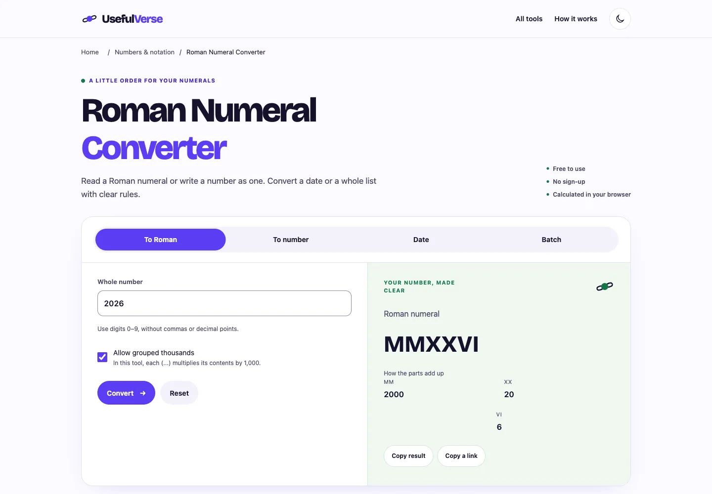

# Roman Numeral Converter · candidato nivel A

29-oct-2026 · [PR146](https://github.com/pedronunezwebs-hash/usefulverse/pull/146), fuente [26c8f59](https://github.com/pedronunezwebs-hash/usefulverse/commit/26c8f59dbe197f0295be1d81a6ccb7f44796712e). Rama `feat/roman-numeral-planeta`, sobre [PR145](https://github.com/pedronunezwebs-hash/usefulverse/pull/145).
**Preparado, sin publicar ni terminar.** Prioridad3: 2.040 impresiones/tres clics históricos y28 idiomas con impresiones (1–15 oct).
Una URL existente; delta0 URLs públicas, 300 nuevas conservan noindex, cero activaciones.

## Funciones y contenido

Conserva número→romano, romano→número y fechas DMY/MDY/YMD. Añade compatibilidad Unicode,
validación canónica moderna, enteros grandes exactos y lotes mixtos con errores por fila/exportación CSV completa.
El cálculo y la generación de CSV van en un Worker cancelable; no bloquean el hilo de la interfaz.
La vista previa muestra50 filas; el CSV contiene todas. No es un límite de conversiones.

La notación ordinaria cubre1–3999. La opción de miles agrupados es una **convención explícita de esta herramienta**:
cada grupo multiplica por1000: `(IV)`=4000, `(M)`=1000000, `((IV))`=4000000.
No se presenta como norma histórica universal ni como notación apostrófica. No hay cero, negativos ni fracciones
en la notación elegida. Se explica que IIII existe en relojes aunque este validador canónico exige IV.
Los límites prácticos son la memoria/capacidad del dispositivo, sin cuotas de servicio.

Cuatro ejemplos ejecutables, diez FAQ, método, privacidad y [20 intenciones](keywords.json) dentro de la misma página.
Son tareas inferidas, **no volúmenes, posiciones ni preguntas de Google medidas**. Referencias de producto:
[Calculator.net](https://www.calculator.net/roman-numeral-converter.html),
[CalculatorSoup](https://www.calculatorsoup.com/calculators/conversions/roman-numeral-converter.php),
[dCode](https://www.dcode.fr/roman-numerals). Sin plataforma SEO ni API pagada.
Datos independientes: [Unicode](https://www.unicode.org/Public/UCD/latest/charts/nameslist/2150/) y
[MathWorld](https://mathworld.wolfram.com/RomanNumerals.html); no copiar sus textos.



[Móvil](mobile.webp) · [Resultado](mobile-result.webp) · [320px](mobile320.webp) · [Tablet](tablet.webp) ·
[Fecha](date-result.webp) · [CSV/lote](batch.webp) · [Oscuro](dark.webp) · [Fixture RTL](rtl-layout.webp).
Capturas de viewport revisadas; RTL/textos largos son fixtures, **no traducciones aprobadas**.

## Base y aislamiento

Reutiliza página, estilos, fuente y builder compartidos de PR145. El builder ahora admite un Worker propio con hash,
cuyo peso también cuenta en el presupuesto. Date56.676B y Time74.989B conservan sus presupuestos exactos.
No cambia los builders nativos, runtime público, indexabilidad, workflows, modelos ni memoria del traductor.
Build optativo/noindex/sitemap vacío/canonical existente; no aplica noindex a las700 públicas.
Inglés centralizado, todavía fuera de la fuente activa del traductor: incorporarlo revisado en lote separado que preserve
la UI pública antes de esperar sus nuevas traducciones. No reconfigurar el traductor ni traducir manualmente.

## Pruebas ejecutadas

- [Suite Node](tests.json): **3.359 correctas, cero fallos/omisiones**;29 focalizadas finales.
  [16 referencias Unicode/NFKC](references.json), cinco ejemplos MathWorld, los3.999 numerales ordinarios,
  5.000 enteros grandes generados y un entero de10.001 dígitos. No hay pérdida por Number ni recursión de pila.
- [Tres motores](browser.json): **42 controles funcionales/54 geometrías** claro/oscuro, 320–1920px, axe A/AA0.
  Cuatro ejemplos, inválidos, fechas/órdenes, Unicode, enlaces, teclado, offline, permisos y CSV de1.000 filas completo.
  Cancelación real de un lote de10.000 líneas y cálculo posterior sin respuestas antiguas; CSV protege fórmulas.
  Márgenes≥16px, sin scroll de página/errores de consola/terceros; tabla y resultados largos tienen scroll propio.
  Doce apaisados y estrés RTL/textos dobles/texto200. Portapapeles simulado: no certifica el del sistema.
- [Regresiones](regressions.json): etiqueta engañosa de partes de fecha y última fila impar descentrada,
  detectadas en revisión del prototipo, corregidas y cubiertas permanentemente en tres motores.
  El enorme fixture de cancelación se precarga por evento DOM porque el pegado automatizado agotó su tiempo;
  el pegado real automatizado de1.000 líneas y descarga completa sí pasan. No es un fallo público conocido.
- [Lighthouse móvil](lighthouse.json): **100/100/100**, LCP936ms/CLS0,005925/TBT0.
  [Traza fría Slow4G/CPU×4](performance-trace.json): LCP886ms/CLS≈0,01. Laboratorio local, no INP de campo.
  Una cadena local HTML→JS tarda10ms; quedan cabeceras/compresión de entrega real.
- [Peso final](candidate.json): HTML9.584B Brotli, CSS3.957B, JS+Worker3.752B, fuente40.784B: **58.077B**.
  CSS crítico13.932B sin comprimir. Build rechaza exceso y checksum incorrecto de fuente; sin nuevo binario de fuente.
- [Producción](production.json): cuatro navegaciones frescas Chrome, HTTP200/H1 correctos.
  Widget público antiguo:2026→MMXXVI, XIV→14, 29-oct-2026→XXIX / X / MMXXVI.
  Las nuevas funciones/diseño no se han probado en producción: **no hubo despliegue**.
- Gate20 existente pasa; no acredita el texto nuevo. Suite completa precede ajustes finales de presentación;
  funcionales y29 focalizadas se repitieron. Lighthouse/traza/capturas preceden solo una frase FAQ dividida en dos,
  sin cambio funcional/de disposición. No se repiten builds nativos sin cambios.

## Puerta del RUNBOOK §6

| # | Situación |
|---|---|
| 1 Funciona | Referencias, propiedades, extremos e inválidos; tres motores correctos |
| 2 Límites | Sin cupo; alcance de notación y capacidad del dispositivo declarados; CSV íntegro |
| 3 Rejugable | No aplica: conversor determinista |
| 4 Originalidad | Máximo3/988 frases de cinco palabras compartidas:0,30% |
| 5 Ejemplos | Cuatro recalculados automáticamente y por navegador |
| 6 Metadata | Título55/descripción152; específica y honesta |
| 7 Esquema | WebApplication/Breadcrumb/FAQ; respuestas idénticas al DOM |
| 8 Siguiente paso | Tres relacionadas existentes HTTP200; Date ampliada requiere PR144 |
| 9 Claridad | Inglés controlado y convención explícita; aprobación visual Pedro pendiente |
| 10 Rendimiento | Laboratorio dentro de presupuesto; INP de campo pendiente |
| 11 Accesibilidad | axe/teclado/contraste correctos; lector real pendiente |
| 12 RTL/largos | Fixtures correctos; ar/de reales pendientes |
| 13 Idiomas | Solo fuente inglesa; piloto/cobertura/hreflang pendientes |
| 14 Check/release | Gate20 pasa; integración/check/CSP/caché pendientes |
| 15 Siete capas | 1–4 ejecutadas;5–7 parciales por idiomas/dispositivos/revisión |
| 16 Pedro | P-010 compartida; URL candidata/portapapeles/descarga móvil pendientes |
| 17 Peso |58.077B total; todas las partidas dentro de presupuesto |
| 18 Responsive | Nueve anchos/temas/apaisados/estrés; zoom real200/diseño pendientes |

## Traductor

[Lectura por API](translation-status.json):40658885003 terminó `success`, seis vueltas entregadas.
La siguiente40843674935 arrancó automáticamente y mantiene cuatro jobs en su primera vuelta.
Aviso141 actualizado:105.639 entradas exportadas; contadores de unidades solapados, no páginas/idiomas aprobados.
Siete workflows del traductor activos/tres de web deshabilitados; ninguna reconfiguración ni disparo manual.

## Relevo y reproducción

Conservar la pila PR144→PR145→esta rama. No desplegar como candidato de fase0.
Completar idiomas reales, integración/check/CSP/caché, lector/zoom real y P-010 antes de publicar/cerrar.
Siguiente preparación: prioridad4 `barcode-generator`, luego lotes por familia con pruebas comunes y contenido/motores propios.
Todas las1.000 conservan las mismas puertas; no pedir cámara/micrófono ni una batería física innecesaria para este conversor.

Dependencias fijadas del package-lock, instalación selectiva/prefijo/caché propios, sin modelos. Clon ligero con docs de
planificación/mercados para pruebas globales;≥10GB libres, huella≤2GB y un proceso pesado cada vez. Sin Actions de web.

```sh
node --test src/quality/roman-numeral-converter/*.test.mjs
node scripts/build-quality-roman.mjs .qa-roman/site
python3 -m http.server 54839 --bind 127.0.0.1 --directory .qa-roman/site
PLAYWRIGHT_BROWSERS_PATH="$PWD/.qa-roman/browsers" node scripts/security/roman-quality-browser.mjs http://127.0.0.1:54839/ .qa-roman/browser.json
node scripts/security/quality-lighthouse.mjs http://127.0.0.1:54839/tools/roman-numeral-converter/ .qa-roman/lighthouse.json
```

Los perfiles propios se retiran al cerrar. Builds, modelos y cachés no se guardan en Git.
[Recibo de respaldo y retirada](closure.json). Candado LIBRE; consultar ESTADO antes de retomar.
