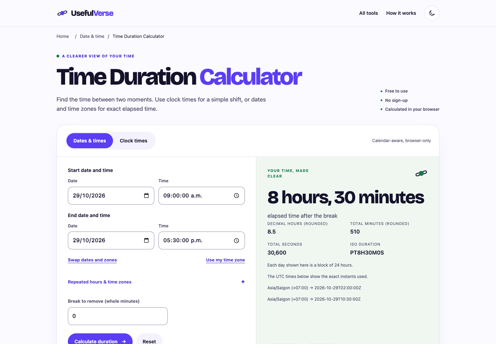

# Time Duration Calculator · candidato nivel A

29-oct-2026 · [PR145](https://github.com/pedronunezwebs-hash/usefulverse/pull/145), fuente [196c73b](https://github.com/pedronunezwebs-hash/usefulverse/commit/196c73b813c7c8bfdbac050caa6a775e2b53393c). Rama `feat/time-duration-planeta`, sobre PR144. **No publicada ni terminada.**
Prioridad 2: 2.511 impresiones/cinco clics históricos, 14 idiomas con impresiones (1–15 oct).
Se mejora la URL existente; **25.625 URLs públicas antes/después, delta 0**. Las 300 siguen noindex.

## Funciones y contenido

Antes: restar dos fechas en la zona del dispositivo, sin aviso de horas inexistentes/repetidas.
El candidato ofrece dos tareas explícitas:

- **Fechas y horas:** zonas de inicio/final independientes, cambio de hora real, rechazo de horas inexistentes,
  elección separada de primera/segunda ocurrencia y los instantes UTC usados en el resultado.
- **Horas de reloj:** cruce de medianoche explícito y distinción entre cero/24 horas para horas iguales.
- Pausas en minutos enteros, desglose, horas/minutos decimales, segundos e ISO; copiar texto/enlace con advertencia de privacidad.
- Cuatro ejemplos ejecutables, diez FAQ y método propio; [20 intenciones](keywords.json) en la misma página.
  Son tareas inferidas, no volúmenes, posiciones ni preguntas de Google medidas. Tres productos de referencia revisados,
  sin plataforma SEO pagada ni páginas duplicadas por cada término.



[Móvil](mobile.webp) · [Resultado móvil](mobile-result.webp) · [Campos a 320 px](native-320.webp) ·
[Tablet](tablet.webp) · [Oscuro](dark.webp) · [Fixture RTL](rtl-layout.webp).
RTL/textos largos son fixtures de geometría con inglés, **no traducciones aprobadas**.

## Base reutilizable para el resto del catálogo

`src/quality/shared/page.mjs`, `style.css` y `font-source.json` reúnen la cabecera, marca, contenido,
FAQ, relacionadas, esquema, fuente y estilos. `scripts/build-quality-page.mjs` comparte construcción y presupuestos.
Cada herramienta conserva su motor, formulario, ejemplos y copia propia: no se convierten en páginas intercambiables.

La extracción conserva **idéntico el HTML de Date Calculator con las mismas URLs de recursos**; su salida final mantiene
los mismos nombres y presupuestos (56.676 B). Se repitió su regresión completa en los tres motores.
Los builders nativos, runtime público, workflows y traducciones existentes no se modifican.
Los dos prototipos son explícitos/noindex, fuera de sitemap y sin publicación; no aplican noindex a las 700 públicas.

Para zonas se usa `temporal-polyfill@1.0.6` (MIT), empaquetado y autoalojado por herramienta, sin parche global.
Evita inventar reglas de cambio de hora; usa los datos de zona del navegador. No hay API de cálculo ni librería remota.
La fuente WOFF2 existente se comparte, sin otro binario duplicado. Licencias acompañan la salida.

## Pruebas ejecutadas

- [3.330 Node correctas, cero fallos/omisiones](tests.json); 58 focalizadas finales: 30 Date + 28 Time.
  Time incluye [14 referencias independientes de Python zoneinfo](reference-python.json), convertidas a UTC antes de restar,
  y 6.000 casos generados. Date conserva sus 10.000 casos y referencias anteriores.
- [Tres navegadores](browser.json): 39 controles funcionales de Time; 54 geometrías claro/oscuro a 320, 360, 390, 414,
  768, 1024, 1280, 1440 y 1920 px. axe A/AA cero; márgenes≥16, sin desbordamiento ni errores de consola/página/terceros.
  Cada control nativo de hora mide≥180 px. Incluye teclado, cuatro ejemplos, pausas, DST, URL, portapapeles simulado,
  permisos denegados, cálculo offline tras la carga, estrés RTL/largos/texto200 y 12 apaisados.
- [Regresión Date del componente compartido](date-shared-regression.json): 36 controles funcionales/54 geometrías axe0,
  tres motores. No acredita sus traducciones ni hardware.
- [Regresiones permanentes](regressions.json): Madrid 29-mar-2026 a las 02:30 se rechazó en el nuevo motor;
  la fuente legacy la acepta normalizada a 03:30. Etiquetas de unidades ausentes y campos nativos recortados se detectaron
  al inspeccionar capturas, se corrigieron y tienen tests. **Ningún arreglo se ha desplegado.**
- [Lighthouse móvil](lighthouse.json): **100/100/100**, LCP1.255ms/CLS0/TBT3ms; y [traza fría CPU×4/Slow4G](performance-trace.json) dentro del presupuesto.
  Son laboratorio local, **no INP de campo ni certificación de dispositivos reales**.
- [Peso final](candidate.json): HTML9.372 B Brotli, CSS3.918 B, JS20.915 B, fuente40.784 B: **74.989 B** estimados.
  CSS crítico13.560 B sin comprimir; sin JS bloqueante. Python sirve sin compresión/cabeceras de Cloudflare;
  la estimación Brotli se calcula separadamente. El build rechaza excesos y fuente con checksum incorrecto.
- [Producción](production.json): cuatro navegaciones frescas en Chrome, HTTP200/H1 correctos. La calculadora anterior
  resolvió 09:00→17:30 como 8,5 horas. El nuevo diseño/DST/zonas no se ha probado en producción.
- Gate existente de20 idiomas correcto; **no aprueba el nuevo texto**. No se repiten los builds nativos sin cambios.
  El check del sitio integrado, CSP/caché, traducciones y entrega real siguen pendientes.

## Puerta del RUNBOOK §6

| # | Situación |
|---|---|
| 1 Funciona | Referencias/extremos/inválidos y tres motores correctos |
| 2 Límites | Sin cupo diario; límites nativos declarados; miles de cálculos. Archivos no aplican |
| 3 Rejugable | No aplica: calculadora determinista |
| 4 Originalidad | 17/970 frases propias de cinco palabras compartidas como máximo:1,75 % |
| 5 Ejemplos | Cuatro recalculados y pausa secundaria comprobada |
| 6 Metadata | Título56/descr.152; promesas revisadas; no volúmenes inventados |
| 7 Esquema | WebApplication/Breadcrumb/FAQ, diez respuestas idénticas al DOM |
| 8 Siguiente paso | Tres URLs existentes/HTTP200; Date ampliada depende de PR144 antes de entregar esta versión |
| 9 Claridad | Revisión de agente, interfaz/inglés controlado ≤20 palabras por frase; diseño Pedro pendiente |
| 10 Rendimiento | Laboratorio correcto; INP de campo pendiente |
| 11 Accesibilidad | axe/teclado/contraste correctos; lector real pendiente |
| 12 RTL/largos | Fixtures correctos; ar/de reales pendientes |
| 13 Idiomas | Solo nueva fuente inglesa; piloto/cobertura/hreflang pendientes |
| 14 Check/release | Gate20 pasa; check integrado/CSP/caché pendientes |
| 15 Siete capas | 1–4 ejecutadas; 5–7 parciales por idiomas/dispositivos/revisión |
| 16 Pedro | P-010 compartida con Date; bloqueada hasta URL candidata. No cámara/micrófono/archivos |
| 17 Peso | Build dentro de todos los presupuestos |
| 18 Responsive | Nueve anchos/temas/apaisados/estrés; zoom real200/aprobación visual pendientes |

## Aviso de GitHub que recibió Pedro

[Issue142](https://github.com/pedronunezwebs-hash/usefulverse/issues/142) se creó a la **1:52 del29-oct, Asia/Saigon**.
La tanda40565692987 terminó con `success`, dejando unidades pendientes y cuarentena: no era un fallo del workflow.
La siguiente40658885003 continuó automáticamente; tres vueltas generadas/entregadas correctamente y cuarta en curso.
[Informe consultado](translation-notification-142.json):104.487 entradas exportadas, sin aprobación nativa/publicación.
Los conjuntos objetivo cambian y los contadores pueden solaparse: no restarlos como páginas o porcentaje terminado.
No se modifican modelos, políticas, memoria, campañas, siete workflows ni avisos; no se cierra el Issue histórico.

## Relevo

1. Conservar PR144 y esta rama dependiente. Integrar primero la base compartida/Date cuando corresponda; no entregar Time primero.
2. Fase0/G1 sigue esperando ventana/verificación de ambos hosts. No desplegar este prototipo como candidato de fase0.
3. Incorporar el inglés revisado al corpus activo en un lote separado que preserve la UI pública, antes de exigir traducciones.
   El traductor no ve automáticamente una rama de prototipos: no cambiar sus workflows ni hacer traducción manual.
4. Completar idiomas reales, integración/check/CSP/caché, lector/zoom real y P-010 con URL antes de publicar/cerrar.
5. Preparar la siguiente prioridad (`roman-numeral-converter`) y luego lotes de familia; usar la base compartida,
   manteniendo motores/copy/tests propios y niveles A/B/C. Mismas puertas en las 1.000, sin una batería física innecesaria por herramienta.

Reproducción: dependencias fijadas del package-lock; instalación selectiva en prefijo/caché propios, sin modelos.
Clon ligero; incluir `docs/planning/usefulverse-1000-2026-10-19` y `docs/markets-no-ch` para las pruebas globales.
≥10GB libres/huella≤2GB; un proceso pesado cada vez; sin Actions de web.

```sh
node --test src/quality/date-calculator/*.test.mjs src/quality/time-duration-calculator/*.test.mjs
node scripts/build-quality-time.mjs .qa-time/site
python3 -m http.server 54839 --bind 127.0.0.1 --directory .qa-time/site
PLAYWRIGHT_BROWSERS_PATH="$PWD/.qa-time/browsers" node scripts/security/time-quality-browser.mjs http://127.0.0.1:54839/ .qa-time/browser.json
```

Medición reutilizable, sin Actions: `node scripts/security/quality-lighthouse.mjs http://127.0.0.1:54839/tools/time-duration-calculator/ .qa-time/lighthouse.json`. Usa un perfil nuevo y lo retira al terminar; evita puertos DevTools obsoletos.

Los perfiles del harness se retiran al cerrar. No se guardan builds, modelos ni cachés en Git.

[Recibo de respaldo y retirada](closure.json). Candado LIBRE; consultar ESTADO antes de retomar.
